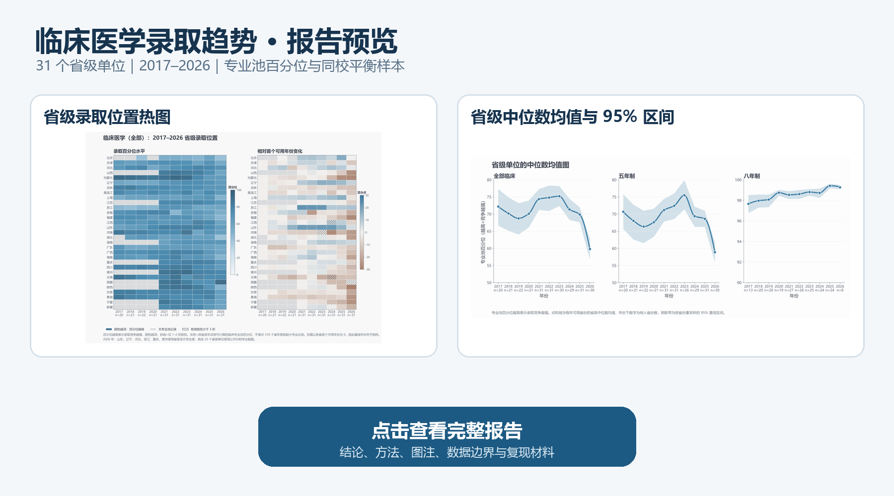

# 临床医学录取竞争位置变化：2017-2026

基于中国大陆 31 个省级行政区专业级录取数据，观察临床医学本科专业在省内专业池中的相对录取位置。

这个项目试图回答一个常见但很少有长期、跨省、专业级公开证据的问题：临床医学的录取热度和竞争位置，近几年是否真的在下降？

[](REPORT.md)

**→ [打开完整报告：结论、方法、图注与数据边界](REPORT.md)**

[完整报告](REPORT.md) | [讨论区](https://github.com/DietCokeEverydayDrinker/clinical-medicine-admission-trends-cn/discussions) | [数据质量审计](DATA_QUALITY_AUDIT.md) | [研究纳入资格审计](DATA_ELIGIBILITY_AUDIT.md) | [分析口径](ANALYSIS_METHODS.md) | [全部数值结果](ANALYSIS_RESULTS_FIRST_PASS.md)

## 先看结论

- 全部临床医学的省级均值从 2023 年 75.2 降至 2025 年 69.9，2026 年进一步降至 59.8。
- 2025 年是一个清晰的同步下移节点。72.4% 的可配对省份下降，省级均值下降 1.9 个百分点。
- 2026 年合并均值的跌幅明显更大，但来源覆盖和院校构成发生明显变化。全部院校均值变化为 -10.0 个百分点，固定同校后为 -0.8 个百分点。
- 固定同一批院校后，逐校变化仍然广泛为负。全部临床中位变化 -2.52 个百分点，73.7% 的学校与省份配对下降；五年制中位变化 -2.97 个百分点。
- 八年制长期处于接近 99 的高位，2021-2026 固定同校累计变化接近零。该口径覆盖省份和院校较少，不能代表全体临床医学。

数据能支持“录取竞争位置在 2025 年出现明显下移”。它不能直接说明就业质量、收入、岗位数量或行业寿命。

## 项目缘起

2019 年入学时，临床医学八年制在多数人的经验里仍是一个高分、稳定的选择。几年之后，身边出现了越来越具体的反馈：有人准备离开临床，有同学在毕业阶段投出多份简历后没有获得面试，也有 2026 级新生说自己是被调剂进入临床医学八年制的。

这些身边观察没有统计代表性，却解释了为什么值得把公开数据认真整理一遍。项目还有一个记忆锚点，是公共讨论里的“临床医学死于 2025”。它混合了录取分数、就业感受、职业选择和个人情绪。这份数据只检验其中能被量化的一部分。

## 数据覆盖

- 时间：2017-2026 年。
- 地区：中国大陆 31 个省级行政区。
- 目标专业口径：普通本科批临床医学专业最低分或最低位次。
- 分析层级：省级专业池百分位、院校年度中介层、固定同校平衡样本。
- 临床记录：36,866 条。
- 省年覆盖：310/310 个省年单元至少有一条临床医学记录。
- 专业池百分位：270 个省年可计算。
- 考生分布百分位：299 个省年可计算。
- 2026 官方专业级来源：山东、辽宁、河北、浙江、重庆、贵州，共 1,171 条临床记录。
- 2026 公开归档来源：其余 25 个省级单位，共 1,157 条临床记录。

310/310 只表示“有记录”，不表示每个省年都有完整专业池。曲线另要求每个省年至少有 3 所院校。

当前面板仍待一次纳入资格重建。审计发现专科层次院校、专项计划、民族班、
定向就业和中外合作项目混入“普通本科五年制”标签；方向性敏感性结果保持为负，
但精确均值会随纳入规则改变。重建完成前，不将当前精确幅度视为最终主口径。
详见 [研究纳入资格审计](DATA_ELIGIBILITY_AUDIT.md)。

## 核心图件

| 图 | 关注问题 |
|---|---|
| [省级录取位置热图](output/report_figures/fig_heatmap_all_clinical.png) | 31 个省级单位 2017-2026 年的水平和相对变化 |
| [年度轨迹](output/report_figures/fig_average_curves.png) | 全部临床、五年制和八年制的总体变化 |
| [年度同步性](output/report_figures/fig_annual_changes.png) | 哪些年份出现跨省同步下移 |
| [全部院校与固定同校](output/report_figures/fig_balanced_change_2025_2026.png) | 2026 年总均值对院校构成有多敏感 |
| [同校变化分布](output/report_figures/fig_school_change_distribution_2025_2026.png) | 同一批院校的逐校变化分布 |
| [固定同校累计变化](output/report_figures/fig_cumulative_change_2021_2026.png) | 2021-2026 连续同校样本的变化路径 |
| [学制位次差](output/report_figures/fig_track_premium.png) | 五年制与八年制的同省差和同校差 |
| [院校层级梯度](output/report_figures/fig_school_tier_gradient_2025_2026.png) | 省内低、中、高位院校的变化差异 |

## 指标怎么读

`admission_percentile` 是主指标。它表示某专业最低分或最低位次，在同省、同年、同科类、同批次全部专业池中的相对位置。数值越高，录取竞争位置越高。

分析先在同一院校内取专业中位数，再对院校取中位数形成省级年度值。这样可以避免专业条目多的院校获得过高权重。

固定同校样本只保留指定年份内一直出现的同省同校记录。2025 至 2026 比较要求两个年份都有记录，每省至少 3 所共同院校；2021 至 2026 比较要求六个年份都有记录。

专业池百分位和考生分布百分位使用不同分母。报告只比较两者的年度方向，不把两种数值拼成一条连续曲线。

## 数据来源

来源包括：

- 省级教育考试机构发布的专业投档表、最低分表、最低位次表和一分一段表。
- 省级官方完整表格的公开转载页。
- 固定 revision 的 GaokaoCompass 公开基线。
- 中国教育在线、掌上高考等公开接口归档。
- 高校官网、旧站页面、网页存档和其他可校验转载材料。

来源清单记录页面、附件、访问日期、文件哈希、原始行数、标准化行数、目标专业行数和校验状态。A 级表示省级考试院原始专业表，B 级表示完整公开转载、固定 revision 数据或公开接口归档。不同证据等级不混写。

原始附件是否公开再分发需要逐项确认第三方条款。仓库优先公开 URL、SHA-256、清洗结果和分析代码。不能公开再分发的文件只保留来源记录和处理脚本。

## 目录

```text
.
├─ REPORT.md                          # 面向公开阅读的完整报告
├─ DATA_QUALITY_AUDIT.md              # 来源、覆盖、缺口和证据等级
├─ DATA_ELIGIBILITY_AUDIT.md          # 本科层次与招生计划类型的纳入资格审计
├─ ANALYSIS_METHODS.md                # 指标和统计方法
├─ ANALYSIS_RESULTS_FIRST_PASS.md     # 全部数值结果
├─ REPORT_FIGURE_SET.md               # 核心图与支持性图分层
├─ scripts/
│  ├─ build_readme_preview.py         # README 首屏报告预览图
│  ├─ audit_eligibility.py            # 资格标记和 2025-2026 敏感性
│  ├─ build_source_crosswalk.py       # 分析来源与来源清单逐文件对照
│  ├─ analyze_trends.py               # 临床分析层和图件生成
│  ├─ validate_trend_analysis.py      # 表和图自动校验
│  └─ validate_report.py              # 报告链接、图件哈希和措辞边界
└─ output/
   ├─ readme_preview/                 # README 首屏报告预览图
   ├─ report_figures/                 # 报告使用的 8 张核心图
   ├─ figures/                        # 全部临床支持性图
   ├─ clinical_panel_*.csv            # 临床公开分析面板
   ├─ analysis_*.csv                  # 分析表
   └─ clinical_source_manifest.csv    # 临床公开来源清单
```

## 复现

Python 依赖见 `requirements.txt`。

```powershell
python -m venv .venv-analysis
.\.venv-analysis\Scripts\python.exe -m pip install -r requirements.txt

.\.venv-analysis\Scripts\python.exe -m py_compile scripts\build_readme_preview.py scripts\audit_eligibility.py scripts\build_source_crosswalk.py scripts\analyze_trends.py scripts\validate_trend_analysis.py scripts\validate_report.py
.\.venv-analysis\Scripts\python.exe scripts\build_readme_preview.py
.\.venv-analysis\Scripts\python.exe scripts\audit_eligibility.py
.\.venv-analysis\Scripts\python.exe scripts\build_source_crosswalk.py
.\.venv-analysis\Scripts\python.exe scripts\analyze_trends.py
.\.venv-analysis\Scripts\python.exe scripts\validate_trend_analysis.py
.\.venv-analysis\Scripts\python.exe scripts\validate_report.py
```

## 解释边界

这个项目不提供就业质量、收入、岗位数量、职业满意度、培养质量或行业寿命结论。

2026 年可计算院校数下降包含来源覆盖差异，不能写成学校停招、撤销专业或退出招生。院校层级是省内相对录取位置，不是学校官方排名或办学质量。

“临床医学死于 2025”在数据层面能对应到 2025 年录取竞争位置的广泛下移。2026 年合并数据继续下移。这个结果不足以证明医学职业进入长期衰退，也不足以预测未来若干年的招生或就业走势。

## 后续可以接力什么

- 加入招生计划数量，做计划加权分析。
- 比较临床医学与口腔、麻醉、影像、护理等医学内部专业。
- 连接毕业生去向、规培招聘和岗位供给数据。
- 建立省份、院校和年份的分层模型。
- 继续补齐 2017-2020 和西藏地区的来源缺口。

## 引用与许可

代码使用 MIT License。本项目原创文档和整理数据使用 CC BY 4.0。第三方原始材料仍归原权利人，公开再分发前需逐项确认许可。

建议引用格式见 `CITATION.cff`。

## 反馈

如果发现来源错误、口径问题或可补齐的公开文件，欢迎在 [Discussions](https://github.com/DietCokeEverydayDrinker/clinical-medicine-admission-trends-cn/discussions) 讨论，或在 GitHub Issues 中附上具体页面、附件、年份、省份和校验信息。涉及数据处理和结论的修改，请尽量提供可复现证据。
