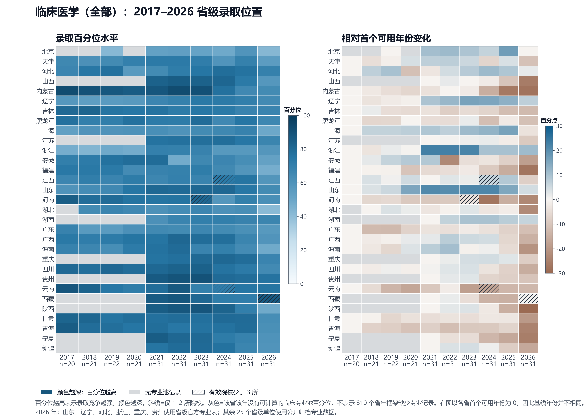
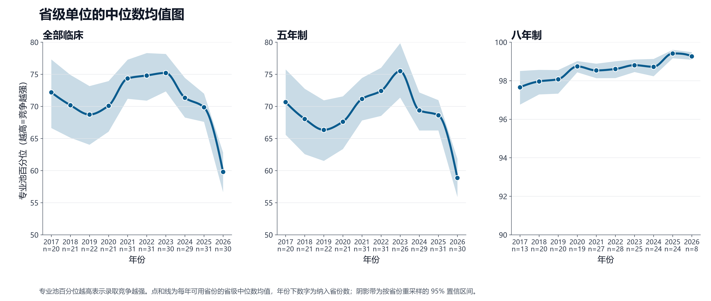
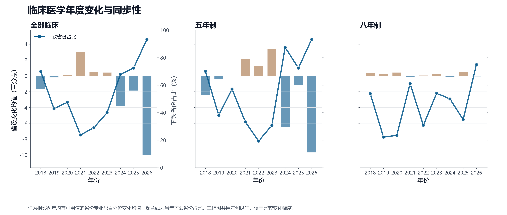
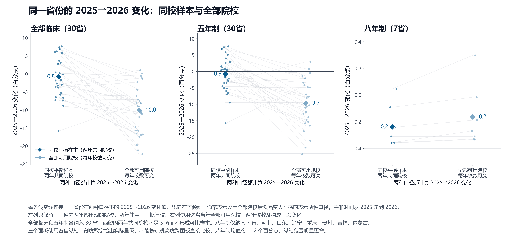
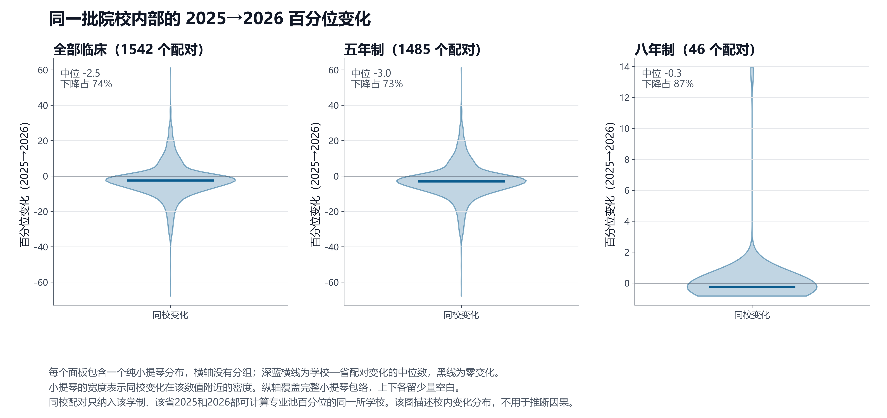
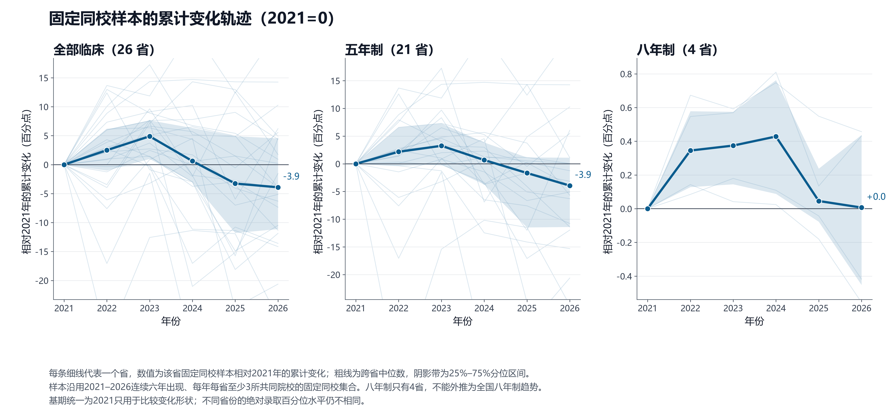
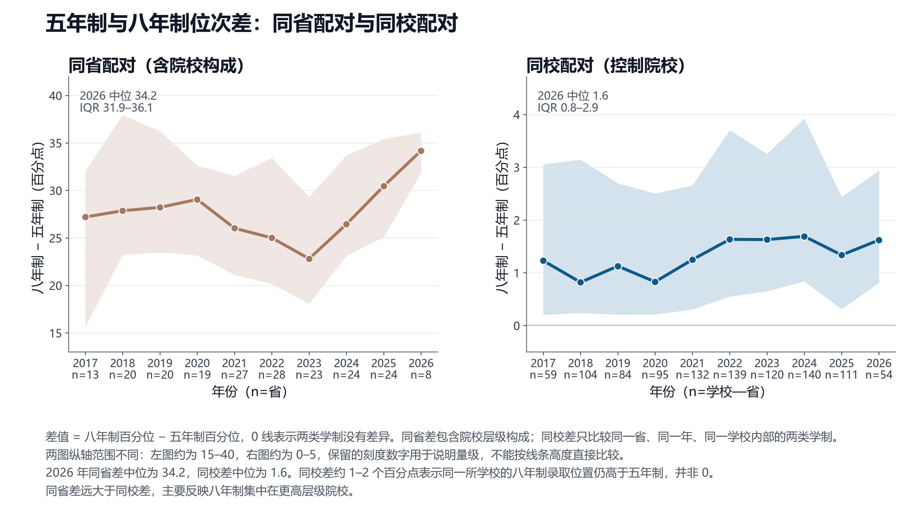
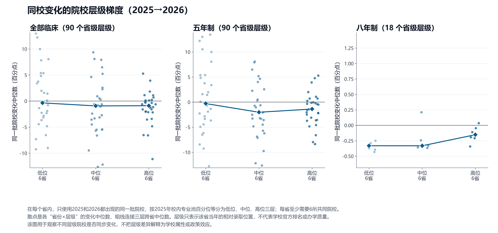

# 临床医学录取竞争位置变化：2017–2026

**基于中国大陆 31 个省级行政区专业级录取数据的可复现分析**

版本：2026-11-18  
分析单位：普通本科批专业最低分或最低位次百分位  
报告性质：描述性数据分析

## 摘要

本项目整理 2017-2026 年中国大陆 31 个省级行政区的临床医学专业级录取记录，建立来源可追溯、缺失不插补、分析可重跑的面板数据。共保留临床医学记录 36,866 条，310 个省年单元至少有一条目标专业记录；其中 270 个省年可以计算专业池录取百分位，299 个省年可以计算考生分布百分位。

核心结果如下。

1. 临床医学录取竞争位置在 2023 年前后处于阶段高位。2025 年出现范围较广的同步下移，全部临床的省级均值下降 1.9 个百分点，72.4% 的可配对省份下降。
2. 2026 年合并面板继续下移，全部临床省级均值由 69.9 降至 59.8。这个总均值对院校构成和公开来源覆盖高度敏感。
3. 固定同一批院校后，下降方向仍然存在。全部临床和五年制的同校变化中位数为 -2.52 和 -2.97 个百分点，约 73% 的学校与省份配对出现下降。
4. 八年制录取位置维持在 99 左右，2021-2026 固定同校累计变化接近零。八年制可用省份和院校较少，这组结果只描述高位培养路径，不能代表全部临床医学。

数据支持的判断是：2025 年是临床医学本科录取竞争位置一个清晰的下移节点，2026 年合并数据继续下移。“临床医学死于 2025”可以视为公共讨论中的形象表达；录取数据只能检验录取竞争位置，不能据此判断职业前景、就业质量或行业寿命。

## 1. 研究缘起与问题

这项整理始于一连串很具体的观察。

2019 年入学时，临床医学八年制在多数人的经验里仍是一个高分、稳定的选择。疫情后的几年，身边关于学医的讨论逐渐多了压力和不确定。到了毕业阶段，这些感受开始落到具体的人身上：有人准备离开临床，有同学投出多份简历后没有获得面试，也有 2026 级新生说自己是被调剂进入临床医学八年制的。2026 年博士课题中期答辩前后，这些零散信息重新聚到一起。

这些经历解释了为什么值得把问题认真查一遍。它们本身属于身边观察，不能代替录取数据，也不能外推到全国。

另一个记忆锚点是公共讨论中的一句话：“临床医学死于 2025”。这句话混合了录取分数、就业感受、职业选择、行业周期和个人情绪。要检验其中可以量化的部分，需要先回答三个问题。

1. 临床医学在各省专业录取中的相对竞争位置是否发生变化。
2. 变化从哪一年开始，是否在多个省份同步出现。
3. 变化来自同一批院校录取位置的真实移动，还是来自院校构成、来源覆盖和统计口径变化。

公开网络中的专业级录取信息分散在省级考试院附件、完整官方表转载页、高校公示、旧站归档和第三方公开接口中。多数材料只覆盖单省、单年或院校专业组层级。能够覆盖多个省份、连续年份并定位到具体专业的数据并不多。本项目的采集、审计、固定同校分析和来源敏感性分析均围绕这一缺口展开。

本报告只讨论录取竞争位置。就业质量、收入、岗位数量、培养质量、职业满意度和行业生命周期需要另一套数据。

## 2. 数据来源与采集方法

### 2.1 范围

- 空间范围为中国大陆 31 个省级行政区，包括 22 个省、5 个自治区和 4 个直辖市。
- 香港、澳门和台湾的招生制度、投档口径与大陆普通高考不同，不进入当前可比面板。
- 时间范围为 2017-2026 年。2017 年是当前能够形成字段相对一致、覆盖多个省份的最低分或最低位次连续面板的起点。
- 主分析使用普通本科批。提前批、专项计划、民族班等不与普通本科批混合。
- 临床医学内部保留全部临床、五年制和八年制三个口径。五年制由明确标注五年制的记录，以及没有长学制标记的普通本科临床记录组成；八年制只纳入专业名或备注明确标注八年制的记录。

### 2.2 数据层

历史采集文件已在分析入口拆分为专题数据。本报告的分析、图表、公开数据包和结论只使用 `subject=clinical` 的临床医学记录。

| 数据层 | 临床医学记录数 | 用途 |
|---|---:|---|
| 2017-2026 实际可得基础面板 | 32,858 | 主面板与 2026 实际可得记录 |
| 本科常规批恢复层 | 4,008 | 补足省年缺口，证据等级不一致 |
| 合并分析面板 | 36,866 | 覆盖 310 个省年单元 |

310/310 表示每个省年至少有一条临床医学目标专业记录，不表示每个单元都有完整专业池。当前 270 个省年能够计算专业池录取百分位，299 个省年能够计算考生分布百分位，264 个省年同时具备两类指标。曲线另要求每个省年至少有 3 所院校，因此图 2 的年度样本数会少于 270。

### 2.3 来源与证据等级

项目将来源角色、省份、年份、批次、专业口径、提供机构、页面、附件、发布日期、访问日期、文件名、SHA-256、原始行数、标准化行数、目标专业行数和校验状态写入来源清单。

主要来源包括：

- 省级教育考试机构发布的投档表、专业最低分表、最低位次表和一分一段表。
- 省级考试机构完整官方表格的公开转载页。
- 固定 revision 的 GaokaoCompass 公开基线数据。
- 中国教育在线、掌上高考等公开接口的归档结果。
- 高校官网、旧站页面、网页存档和公开转载材料。

2026 年数据分两层：

| 层级 | 覆盖 | 临床医学记录 | 用途 |
|---|---:|---:|---|
| 省级考试院官方专业级表 | 山东、辽宁、河北、浙江、重庆、贵州 | 1,171 | A 级主来源 |
| 公开接口归档专业池 | 其余 25 个省级单位 | 1,157 | B 级描述性扩展 |

B 级归档通过分页条数守恒、字段可用性和全专业池重算校验，未逐条回溯到考试院原始附件。记录保持 B 级标记，不写成官方原表。2026 年的全国合并均值和来源敏感性结果需要一起阅读。

### 2.4 清洗与复现

1. 逐省、逐年定位考试院公告、附件、完整转载页、高校公示或可校验的公开归档。
2. 保存原始地址、访问日期和文件哈希，形成文件级来源链。
3. 统一省份、年份、科类、批次、院校、专业、最低分和最低位次字段。
4. 排除专业组级、院校级、提前批和其他不可比记录。
5. 同一省年出现多套来源时，按来源等级和完整度选择一套，不重复计数。
6. 保留缺失，不使用插值、院校线反推或单校记录补全省专业池。
7. 分别计算专业池录取百分位和考生分布百分位，并保留来源层级。

### 2.5 主要限制

- 2017-2025 年主面板仍有相当部分来自二级聚合数据，不能声称每条记录均已回溯到省级考试院原表。
- 2017-2020 年专业池覆盖存在缺口，曲线只使用当年真实可用省份。
- 2026 年官方专业级表覆盖 6 省，其余 25 省使用公开归档专业数据。
- 西藏缺少可用的公开一分一段表，相关考生分布百分位保持缺失。
- 录取百分位和考生分布百分位含义不同，不能拼成一个指标。
- 五年制分类依赖专业名和备注中的培养年限标记，不能替代逐校培养方案核验。

## 3. 指标与统计方法

### 3.1 专业池录取百分位

主指标 `admission_percentile` 表示某专业最低分或最低位次，在同省、同年、同科类、同批次全部专业池中的相对位置。

- 数值越高，录取竞争位置越高。
- 分数池和位次池分别在同一种指标内比较，不跨指标混合。
- 同一院校存在多个目标专业记录时，先取院校中位数，再对院校取中位数形成省级年度值。
- 曲线只使用当年至少 3 所院校的省级单元。
- 热图保留 1-2 所院校的单元，并用斜线标记。

### 3.2 考生分布百分位

稳健性指标 `candidate_percentile` 表示目标最低分在同省、同年、同科类考生一分一段分布中的位置。该指标不依赖全专业最低分池，用于核验主指标方向。

### 3.3 固定同校样本

固定同校样本只保留指定年份内持续出现的同省同校记录。

- 2025 至 2026 比较要求同一学校两个年份都有可计算百分位，每省至少 3 所共同院校。
- 2021 至 2026 比较要求同一学校六个年份均出现，每省每年至少 3 所共同院校。
- 2025 至 2026 全部临床和五年制各覆盖 30 省；八年制覆盖 7 省。
- 2021 至 2026 长面板覆盖全部临床 26 省、五年制 21 省、八年制 4 省。

固定同校减少院校进入退出对均值的影响，不能消除来源质量和专业池结构变化。

### 3.4 不确定性与解释边界

- 年度均值区间使用按省重采样 2,000 次的 bootstrap 区间。
- 留一省分析依次排除一个省份，检查总体均值是否由单省主导。
- 院校层级是省内相对录取位置分层，不是官方大学排名或办学质量。
- 全部可用院校与固定同校的差值包含院校数量、进入退出、来源覆盖和省内结构变化，不作严格因果分解。

## 4. 数据图景

### 图 1：31 个省级单位的临床医学录取位置



左图显示各省当年可计算的临床医学专业池录取百分位，右图显示相对各省首个可用年份的变化。颜色越深，录取竞争位置越高；蓝色表示相对升温，褐色表示相对降温；灰色表示当年没有可计算专业池；斜线表示有效院校少于 3 所。

临床医学在多数省份长期处于较高百分位。2024 年以后，相对变化列中的褐色格子增多，2025 和 2026 年尤其明显。各省起点和可用年份不同，右图只用于观察方向和幅度。

### 图 2：年度总体轨迹



全部临床和五年制在 2023 年前后达到阶段高位，随后连续下移。全部临床 2025 年均值为 69.9，2026 年为 59.8；五年制 2025 年为 68.6，2026 年为 58.9。八年制长期接近 99，2026 年为 99.3。

三条轨迹需要分开解释。全部临床与五年制的样本覆盖面较广，能够描述本科临床的主要变化。八年制只有少数省份和院校进入样本，适合观察高位精英层的相对稳定性，不能代表全体临床医学报考热度。

### 图 3：年度变化与同步性



柱形表示相邻年份都有可用值的省份均值变化，折线表示当年下跌省份占比。

- 2025 年全部临床均值下降 1.9 个百分点，72.4% 的配对省份下降，31.0% 下降至少 5 个百分点。
- 2026 年合并数据均值下降 10.0 个百分点，93.3% 的配对省份下降，76.7% 下降至少 5 个百分点。
- 2026 年跌幅较大，同时伴随公开归档覆盖差异，具体幅度需要结合固定同校和来源敏感性结果阅读。

这组结果支持“2025 年是同步下移节点”的判断。2026 年合并均值不能直接当作所有原有院校的等量变化。

### 图 4：全部院校与固定同校的 2025 至 2026 比较



浅蓝点使用当年全部可用院校，深蓝点使用两年都出现的同一批院校。全部临床：全部院校均值变化 -10.0 个百分点，固定同校变化 -0.8 个百分点；五年制分别为 -9.7 和 -0.8；八年制分别为 -0.2 和 -0.2。

这组对照说明，2025 至 2026 的全部院校均值受到院校构成和来源覆盖的强烈影响。固定同校后，全部临床和五年制仍为轻微下降。

### 图 5：同校变化分布



每个面板是一个纯小提琴分布，深蓝横线为中位数，黑线为零变化。全部临床包含 1,542 个学校与省份配对，变化中位数 -2.52 个百分点，73.7% 的配对下降；五年制包含 1,485 个配对，变化中位数 -2.97，73.3% 下降；八年制包含 46 个配对，变化中位数 -0.27，87.0% 下降。

固定同校后，下降在全部临床和五年制样本中十分广泛，典型变化幅度相对温和。八年制下降比例较高，绝对变化很小，不能和五年制的百分点幅度直接比较。

### 图 6：2021 至 2026 固定同校累计变化



该图以 2021 年为 0，逐年计算同一批院校相对 2021 年的累计变化。粗线为跨省中位数，阴影带为 25% 至 75% 分位区间。

- 全部临床 2026 年相对 2021 年的中位累计变化为 -3.91 个百分点，覆盖 26 省。
- 五年制为 -3.94 个百分点，覆盖 21 省。
- 八年制为 +0.01 个百分点，覆盖 4 省。

全部临床和五年制在 2023 年前后达到阶段高点，随后持续回落。八年制样本仅 4 省，不能外推为全国八年制趋势。

### 图 7：五年制与八年制的位次差



同省配对把各省八年制省级值与五年制省级值直接相减，同校配对只使用同省、同年、同校同时存在两类培养路径的记录。

2026 年同省配对中位差为 34.2 个百分点，覆盖 8 省；同校配对中位差为 1.6 个百分点，覆盖 54 个学校与省份配对。八年制与五年制的同省差距主要来自院校层级构成。同一所学校内部，八年制录取位置仍略高，差距远小于省级表面差距。

### 图 8：省内相对录取层级的变化梯度



该图在每个省内只使用 2025 和 2026 都出现的学校，并按 2025 年校内专业池百分位分为低位、中位、高位三层。层级只表示省内相对录取位置，不是学校官方排名或质量。

全部临床低、中、高位省级中位变化分别为 -0.35、-0.93、-0.88 个百分点。五年制分别为 -0.29、-2.02、-1.39 个百分点。各层均出现下降，五年制中位和高位院校的变化更明显。八年制只有 6 省满足分层门槛，仅作补充观察。

## 5. 结论与解释边界

### 5.1 数据能够支持的结论

1. 临床医学在 2017 至 2023 年保持较高录取竞争位置，2024 年之后进入连续下移阶段。
2. 2025 年可以观察到一个清晰的跨省同步下移节点。全部临床均值下降 1.9 个百分点，72.4% 的配对省份下降。
3. 2026 年合并面板继续下移，下降省份占比升至 93.3%。2026 年跌幅受到来源覆盖和院校构成影响，固定同校结果更适合解释同一批院校的变化。
4. 同一批院校内部仍有广泛下移。全部临床和五年制的同校变化中位数约为 -2.5 和 -3.0 个百分点，约 73% 的配对下降。
5. 八年制录取位置长期处于高位，2021 至 2026 累计变化接近零。该结果只覆盖少数省份和院校，不能代表全体临床医学。
6. 2025 至 2026 全部院校均值变化与固定同校变化差距很大，报告全国幅度时必须同时说明样本口径。
7. 留一省结果显示，全部临床排除任一省份后的均值仍落在 -10.39 至 -9.59 个百分点，总体方向没有被单一省份主导。

### 5.2 对“临床医学死于 2025”的判断

从录取数据看，2025 年确实是临床医学本科录取竞争位置一个清晰的下移节点。2026 年合并数据继续下移，具体跌幅受到来源覆盖和院校构成影响。

更准确的表述是：

> 临床医学本科专业的录取竞争位置在 2025 年出现明显下移，2026 年合并数据继续下移，八年制与普通五年制的变化幅度存在明显差异。

“临床医学死于 2025”可以理解为公共讨论对录取热度变化的形象表达。它描述不了医生收入、岗位数量、就业质量或行业寿命。

### 5.3 本报告不能回答的问题

- 临床医学就业质量是否下降或上升。
- 医生收入、岗位数量或职业稳定性是否发生变化。
- 某一政策是否造成了全部变化。
- 院校层级是否等同于学校质量或办学水平。
- 2026 合并均值是否等于所有原有院校的同步跌幅。
- 八年制少数省份的结果是否可以外推到全国。

这些问题需要招生计划、毕业生去向、招聘岗位、薪酬、执业流动和培养质量等独立数据。后续如果有人接力，最值得补的是招生计划加权、医学内部不同专业的比较、毕业生去向和正式分层模型。

## 6. 可复现材料

### 6.1 核心数据

- [`output/clinical_panel_2017_2026_available.csv`](output/clinical_panel_2017_2026_available.csv)：2017-2026 实际可得临床医学基础面板。
- [`output/clinical_panel_2017_2026_recovered.csv`](output/clinical_panel_2017_2026_recovered.csv)：基础面板与恢复层合并后的临床医学面板。
- [`output/clinical_panel_2017_2026_candidate_percentile.csv`](output/clinical_panel_2017_2026_candidate_percentile.csv)：附有考生分布百分位的临床医学分析面板。
- [`output/analysis_province_year.csv`](output/analysis_province_year.csv)：省级年度分析层。
- [`output/analysis_school_year.csv`](output/analysis_school_year.csv)：院校年度中介层。

本地历史归档与公开包分开保存。GitHub 发布层只包含临床分析面板、临床来源清单、分析代码和图件。

### 6.2 来源与质量审计

- [`output/clinical_source_manifest.csv`](output/clinical_source_manifest.csv)：临床公开来源清单。
- [`output/clinical_data_completion_ledger.csv`](output/clinical_data_completion_ledger.csv)：310 个省年临床记录补全台账。
- [`output/clinical_numerator_310_cell_audit.csv`](output/clinical_numerator_310_cell_audit.csv)：310 个临床单元的分子、专业池和分布覆盖逐项审计。
- [`output/clinical_metric_coverage_by_year.csv`](output/clinical_metric_coverage_by_year.csv)：两类临床指标的逐年覆盖。
- [`output/clinical_candidate_distribution_remaining_gaps.csv`](output/clinical_candidate_distribution_remaining_gaps.csv)：临床考生分布剩余缺口。
- [`DATA_QUALITY_AUDIT.md`](DATA_QUALITY_AUDIT.md)：数据质量审计。

第三方网页、PDF、图片和数据库的再分发权利需要逐项确认。公开仓库可以长期保存来源 URL、SHA-256、处理结果和采集脚本。原始附件是否进入 Git 或 Release，需要按来源分别检查。

### 6.3 方法与结果

- [`ANALYSIS_METHODS.md`](ANALYSIS_METHODS.md)：指标、平衡样本、区间和解释边界。
- [`ANALYSIS_RESULTS_FIRST_PASS.md`](ANALYSIS_RESULTS_FIRST_PASS.md)：全部分析数值和稳健性结果。
- [`REPORT_FIGURE_SET.md`](REPORT_FIGURE_SET.md)：核心图件与支持性图件分层。
- [`scripts/analyze_trends.py`](scripts/analyze_trends.py)：临床分析层和图表生成代码。
- [`scripts/validate_trend_analysis.py`](scripts/validate_trend_analysis.py)：数据表和图件自动校验代码。

### 6.4 复现命令

```powershell
.\.venv-analysis\Scripts\python.exe -m py_compile scripts\export_clinical_panel.py scripts\analyze_trends.py scripts\validate_trend_analysis.py scripts\validate_report.py
.\.venv-analysis\Scripts\python.exe scripts\export_clinical_panel.py
.\.venv-analysis\Scripts\python.exe scripts\analyze_trends.py
.\.venv-analysis\Scripts\python.exe scripts\validate_trend_analysis.py
.\.venv-analysis\Scripts\python.exe scripts\validate_report.py
```

## 7. 使用边界与继续研究

欢迎使用、复核和继续分析。引用本报告时应同时保留指标定义、年份范围和数据来源层级。公开传播时使用“录取竞争位置”“专业池百分位”“阶段性下移”“固定同校样本”等可定义术语。就业、收入、行业生命周期和政策归因保持在数据分析边界之外。

后续最值得补充的数据是招生计划、医学内部不同专业的录取位置、毕业生去向、规培招聘和专业岗位供给。任何新增分析都应继续区分来源等级、样本口径和同校平衡样本，避免把不同分母或不同覆盖范围的数值拼成一条全国曲线。
